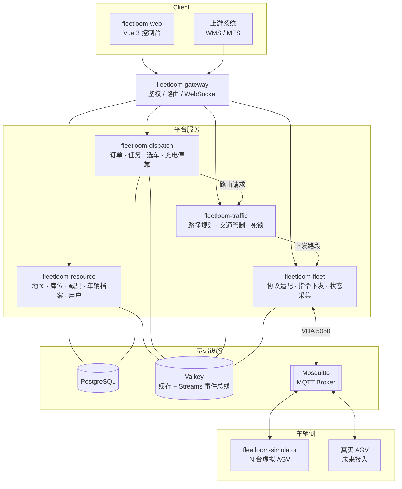
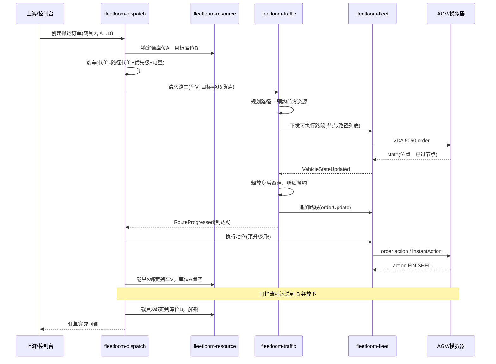
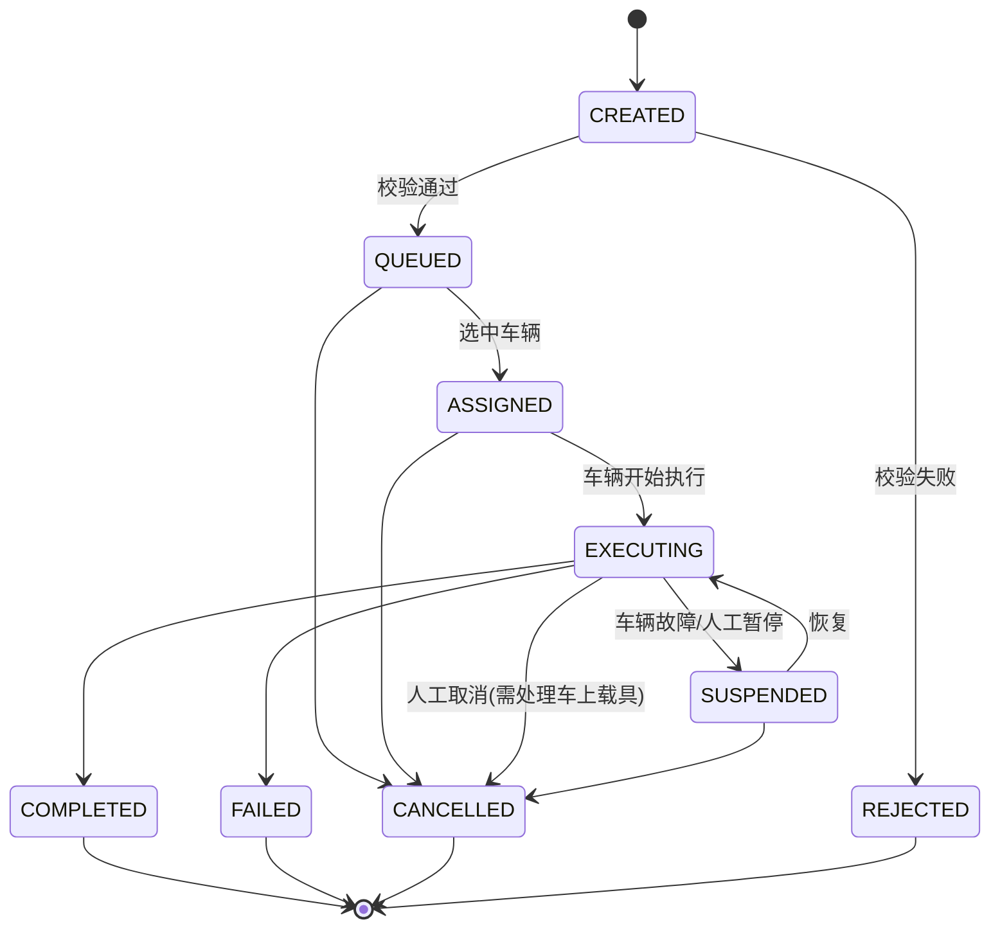

# Fleetloom AGV 管理控制平台 需求文档

> 版本：v0.2（草稿） · 日期：2026-10-18
> 说明：本文档是后续实现的依据。需求条目带编号（如 `MAP-01`），实现、提交和测试用例都引用编号。修改需求时同步改版本号并在文末「变更记录」登记。

---

## 1. 项目概述

Fleetloom 是面向仓储/产线场景的多 AGV 管理控制平台（Robot Control System）。后端 Java、前端 Vue，按业务领域拆分为独立服务；第一阶段用 AGV 模拟器替代真车完成端到端联调，未来真车通过同一套协议接入，平台代码不需要区分真车与模拟车。

### 1.1 目标

- 可视化构建和维护地图（点位、路径、区域），作为所有服务共享的唯一空间基准。
- 管理存储对象（库区、库位）和搬运对象（载具及其上的货物）。
- 管理 AGV 车队：注册、实时监控、手动控制、充电、停靠、故障处理。
- 接收搬运任务，自动分配车辆、规划路径、交通管制，驱动车辆执行。
- 车辆接入层协议标准化（VDA 5050），模拟器与真车无差别接入。

### 1.2 范围

| 范围内（v1） | 范围外（v1 不做，可预留接口） |
| --- | --- |
| 地图构建与版本管理 | 车载 SLAM 建图与定位算法（由车体/模拟器负责） |
| 存储对象管理 | WMS / MES 的完整业务（只提供对接 API） |
| 搬运对象管理 | 电梯、自动门、输送线等外设联动（二期） |
| 车辆管理与手动控制 | 多仓库 / 多租户 |
| 任务调度、路径规划、交通管制 | 3D 可视化 |
| 车辆通信网关（VDA 5050 / MQTT） | 移动端 App |
| AGV 模拟器 | |
| Web 控制台、用户权限、日志告警 | |

---

## 2. 术语

| 术语 | 含义 |
| --- | --- |
| 地图（Map） | 一个场地的拓扑图 + 背景图，有版本；同一时刻只有一个「生效版本」 |
| 点位（Point / Node） | 地图上的离散位置，车辆只能停在点位上 |
| 路径（Path / Edge） | 两点之间可通行的有向线段（直线或贝塞尔曲线） |
| 区域（Area） | 地图上的多边形范围，如互斥区、限速区、禁行区 |
| 库区（Zone） | 存储对象的逻辑分组，如「原料区」「成品区」 |
| 库位（Storage Location） | 可放置一个载具的位置，绑定一个地图点位作为取放点 |
| 载具（Carrier） | 被 AGV 搬运的物理对象：托盘、货架、料车、料箱 |
| 货物（Goods） | 载具上承载的物料（SKU + 数量），v1 只做简单记录 |
| 车型（Vehicle Type） | 一类 AGV 的参数：尺寸、速度、载重、支持动作 |
| 车辆（Vehicle） | 一台具体的 AGV（真车或模拟车） |
| 搬运订单（Transport Order） | 上游下达的业务请求：「把载具 X 从 A 搬到 B」 |
| 任务（Task） | 调度器把订单分解后交给某台车执行的步骤序列 |
| 资源（Resource） | 交通管制的最小单位：点位、路径、互斥区 |
| VDA 5050 | 德国汽车工业协会制定的 AGV 与主控系统通信标准，基于 MQTT + JSON |

---

## 3. 总体架构

### 3.1 服务划分

原则：**按领域拆分、单一数据所有权、车辆协议隔离**。每个服务独占自己的数据库 schema，其他服务只能通过 API 或事件访问。

| 服务 | 模块名 | 职责 | 数据所有权 |
| --- | --- | --- | --- |
| API 网关 | `fleetloom-gateway` | 统一入口、鉴权（JWT）、路由、WebSocket 转发、限流 | 无 |
| 基础资源服务 | `fleetloom-resource` | 地图、库区库位、载具货物、车型与车辆档案、用户权限、系统配置 | 地图、存储对象、搬运对象、车辆档案、用户 |
| 任务调度服务 | `fleetloom-dispatch` | 接收搬运订单、分解任务、选车派车、充电/停靠策略、任务状态机、上游回调 | 订单、任务 |
| 路径规划与交通管制服务 | `fleetloom-traffic` | 路径搜索、资源预约与释放、互斥区、死锁检测与解除 | 运行时预约表（内存 + Redis 快照） |
| 机器人控制服务 | `fleetloom-fleet` | 车辆连接管理、协议适配（VDA 5050 等）、指令下发、状态采集、心跳与离线判定 | 车辆实时状态（Redis） |
| AGV 模拟器 | `fleetloom-simulator` | 模拟多台 AGV 的运动、动作、电量、故障，通过 VDA 5050 与 `fleetloom-fleet` 通信 | 模拟场景配置 |
| Web 控制台 | `fleetloom-web` | Vue 前端 | 无 |

说明：
- 用户要求「基础管理作为一个服务」，所以地图、存储对象、搬运对象、车辆档案合在 `fleetloom-resource`，内部按包分模块（`map` / `storage` / `carrier` / `vehicle` / `system`），边界清晰，日后可按包直接拆出独立服务（最可能先拆的是 `map`）。
- 车辆的**档案**（静态配置）归 `fleetloom-resource`，车辆的**实时状态**归 `fleetloom-fleet`，两者通过车辆编码关联。
- `fleetloom-simulator` 不依赖平台任何内部代码，只共享协议模块 `fleetloom-protocol-vda5050`，确保它和真车处在同一位置。

### 3.2 架构图



### 3.3 通信方式

| 场景 | 方式 | 说明 |
| --- | --- | --- |
| 前端 → 后端 | HTTP REST（JSON） | 经网关，统一前缀 `/api/{service}/v1/...` |
| 后端 → 前端实时推送 | WebSocket（JSON 消息） | 由网关推送模块承载，车辆位置、任务状态、告警；推送频率 ≤ 5 Hz/车 |
| 服务间同步查询 | HTTP（Spring `@HttpExchange` 接口） | 例：dispatch 查询库位详情 |
| 服务间异步事件 | Redis Streams（Valkey，消费者组） | 通过 `fleetloom-common` 的 `EventBus` 接口封装，以后可替换为 Kafka / RabbitMQ |
| 平台 ↔ 车辆 | MQTT（VDA 5050 v2.0） | 由 `fleetloom-fleet` 独占，其他服务不直接接触车辆协议 |

### 3.4 核心事件

| 事件 | 发布者 | 主要订阅者 |
| --- | --- | --- |
| `MapPublished`（新地图版本生效） | resource | traffic、fleet、simulator、web |
| `StorageLocationChanged` | resource | dispatch、web |
| `CarrierMoved` | resource | web |
| `VehicleStateUpdated`（位置、电量、动作进度、错误） | fleet | traffic、dispatch、web |
| `VehicleConnectionChanged`（上线/离线） | fleet | dispatch、traffic、web |
| `TransportOrderStatusChanged` | dispatch | web、上游回调 |
| `RouteProgressed`（路段完成 / 到达目的地） | traffic | dispatch |
| `TrafficBlocked` / `DeadlockDetected` | traffic | dispatch、web（告警） |

### 3.5 一次搬运的主流程



职责分界：**dispatch 决定「谁去哪里干什么」；traffic 决定「怎么走、现在能走多远」；fleet 负责「把话说给车听、把车的话翻译回来」**。

---

## 4. 基础资源服务：地图管理（`fleetloom-resource/map`）

### 4.1 数据模型

- **地图 Map**：`id, code, name, description, activeVersionId`
- **地图版本 MapVersion**：`id, mapId, versionNo, status(DRAFT/PUBLISHED/ARCHIVED), publishedAt, publishedBy`
- **背景图 MapBackground**：`versionId, imageUrl, resolution(m/px), originX, originY`（兼容 ROS `map.yaml + pgm/png`）
- **点位 Point**：`id, versionId, code, x, y(米), theta(弧度，可空), type, properties(JSON)`
  - `type`：`NORMAL` 普通点 / `WORKSTATION` 工作站点 / `CHARGING` 充电点 / `PARKING` 停靠点 / `ROTATION` 允许原地旋转点 / `WAITING` 避让等待点
- **路径 Path**：`id, versionId, code, fromPointId, toPointId, direction(UNI/BI), shape(LINE/BEZIER), controlPoints, maxSpeed, vehicleOrientation(FORWARD/BACKWARD/ANY), allowedVehicleTypes, weightFactor, enabled`
- **区域 Area**：`id, versionId, code, type(MUTEX/SPEED_LIMIT/FORBIDDEN/CHARGING_ZONE), polygon, properties`

坐标系与单位：右手坐标系，原点在地图左下角，x 向右、y 向上，长度单位米，角度弧度（与 VDA 5050 一致）。前端渲染时自行翻转 y 轴。

### 4.2 功能需求

| 编号 | 需求 | 优先级 |
| --- | --- | --- |
| MAP-01 | 地图的增删改查；一个地图有多个版本，编辑只发生在 DRAFT 版本上 | P0 |
| MAP-02 | 导入背景图（PNG/JPG，或 ROS `yaml + pgm`），设置分辨率与原点 | P0 |
| MAP-03 | 可视化编辑：新增/移动/删除点位，按两点连线生成路径，设置单双向；支持框选、多选批量修改属性、撤销/重做、网格吸附 | P0 |
| MAP-04 | 路径支持直线和三阶贝塞尔曲线，长度自动计算 | P1 |
| MAP-05 | 区域绘制（多边形），类型含互斥区、限速区、禁行区 | P1 |
| MAP-06 | 发布校验：孤立点、重复编码、悬空路径、充电点不可达、工作站点无库位绑定等，错误阻止发布、警告允许发布 | P0 |
| MAP-07 | 发布：DRAFT → PUBLISHED，旧版本变 ARCHIVED，发出 `MapPublished` 事件；有车辆执行任务时需二次确认，交通管制服务在所有车辆处于静止后切换 | P0 |
| MAP-08 | 基于任意历史版本复制出新草稿；版本间差异对比（新增/删除/修改的点、路径） | P2 |
| MAP-09 | 地图导入导出（平台自有 JSON 格式；可选兼容 VDA LIF 布局交换格式） | P1 |
| MAP-10 | 提供只读查询 API：按版本获取完整拓扑（供 traffic、simulator 加载），按编码查点位/路径 | P0 |
| MAP-11 | 批量生成：按行列间距自动生成网格点和路径（用于快速搭建测试场景） | P2 |

---

## 5. 基础资源服务：存储对象管理（`fleetloom-resource/storage`）

### 5.1 数据模型

- **库区 Zone**：`id, code, name, type(RAW/WIP/FINISHED/BUFFER/...可配置字典), description`
- **库位 StorageLocation**：
  `id, code, zoneId, type, mapId, accessPointCode(取放点位), accessTheta(取放朝向), level(层号，地堆为0), height(米), allowedCarrierTypes, capacity(默认1), status, lockOwner, enabled`
  - `type`：`GROUND` 地堆 / `RACK` 货架层 / `STATION` 产线工位 / `BUFFER` 缓存位
  - `status`：`EMPTY` 空 / `OCCUPIED` 占用 / `LOCKED_IN` 入库锁定 / `LOCKED_OUT` 出库锁定 / `DISABLED` 禁用

库位绑定的是点位**编码**而不是点位 ID，这样地图换版后只要编码不变，绑定关系仍有效；发布校验（MAP-06）检查绑定的编码是否存在。

### 5.2 功能需求

| 编号 | 需求 | 优先级 |
| --- | --- | --- |
| STO-01 | 库区增删改查 | P0 |
| STO-02 | 库位增删改查；支持在地图编辑器中点选点位直接创建库位 | P0 |
| STO-03 | 批量创建：按「排-列-层」规则生成库位编码（如 `A-01-02-1`） | P1 |
| STO-04 | 库位状态机：空 ↔ 入库锁定 → 占用 ↔ 出库锁定 → 空；禁用可从任意非锁定状态进入。锁定带持有者（订单号），只有持有者可以解锁 | P0 |
| STO-05 | 锁定接口必须原子（数据库乐观锁 `version` 字段），供 dispatch 在下单时同时锁定源和目标 | P0 |
| STO-06 | 查询：按库区、状态、载具类型筛选；「找一个可用空库位」接口（按库区 + 载具类型 + 策略：最近 / 顺序 / 随机） | P0 |
| STO-07 | 在监控地图上以颜色显示库位状态 | P1 |
| STO-08 | Excel 导入导出 | P2 |

---

## 6. 基础资源服务：搬运对象管理（`fleetloom-resource/carrier`）

### 6.1 数据模型

- **载具类型 CarrierType**：`id, code, name, category(PALLET/SHELF/CART/BIN), length, width, height, maxLoad(kg), compatibleVehicleTypes`
- **载具 Carrier**：`id, code(条码/RFID), typeId, status(IDLE/IN_TRANSIT/DISABLED), locationType(STORAGE/VEHICLE/NONE), locationRef(库位编码或车辆编码), lastMovedAt`
- **货物 Goods**（v1 简化）：`id, carrierId, sku, name, quantity, unit, batchNo`
- **移动记录 CarrierMovement**：`carrierId, fromRef, toRef, orderNo, movedAt`

### 6.2 功能需求

| 编号 | 需求 | 优先级 |
| --- | --- | --- |
| CAR-01 | 载具类型增删改查，配置与车型的兼容关系 | P0 |
| CAR-02 | 载具增删改查；可手动绑定到库位或解绑（人工搬动后校正） | P0 |
| CAR-03 | 载具位置由 dispatch 在任务步骤完成时更新（取货：库位 → 车；放货：车 → 库位），同时更新库位状态，二者在同一事务中完成 | P0 |
| CAR-04 | 一个载具同一时刻只能在一个位置；一个库位不超过其容量 | P0 |
| CAR-05 | 载具上货物的增删改（v1 仅记录，不参与调度决策） | P1 |
| CAR-06 | 载具移动历史查询 | P1 |
| CAR-07 | 按载具编码下单：上游只给载具编码和目标，平台自动查出源库位 | P1 |

---

## 7. 车辆管理

车辆管理横跨两个服务：**档案**在 `fleetloom-resource/vehicle`，**实时状态与控制**在 `fleetloom-fleet`。前端「车辆」页面同时调两边。

### 7.1 数据模型

- **车型 VehicleType**（resource）：`id, code, name, category(JACKING 顶升潜伏/FORKLIFT 叉车/ROLLER 辊筒/TOWING 牵引), length, width, rotationRadius, maxSpeed, maxAcceleration, maxLoad, supportedActions, batteryCapacity`
- **车辆 Vehicle**（resource）：`id, code, name, typeId, protocol(VDA5050/CUSTOM), manufacturer, serialNumber, mqttInterfaceName, initialPointCode, chargeThresholdLow, chargeThresholdHigh, enabled, simulated(bool)`
- **车辆实时状态 VehicleState**（fleet，Redis）：
  `code, connection(ONLINE/OFFLINE/CONNECTION_BROKEN), mode(AUTOMATIC/MANUAL/SEMIAUTOMATIC), x, y, theta, mapId, lastNodeId, velocity, battery(%), charging, loaded, carrierCode, driving, paused, currentOrderId, actionStates[], errors[], lastUpdateTime`

### 7.2 功能需求

| 编号 | 需求 | 服务 | 优先级 |
| --- | --- | --- | --- |
| VEH-01 | 车型增删改查 | resource | P0 |
| VEH-02 | 车辆档案增删改查；新增后 fleet 自动订阅该车 MQTT 主题 | resource + fleet | P0 |
| VEH-03 | 实时状态列表与详情（位置、电量、模式、当前任务、错误） | fleet | P0 |
| VEH-04 | 调度开关：「接单 / 不接单」，不接单的车不被 dispatch 选中，但可手动控制 | dispatch | P0 |
| VEH-05 | 手动指令：暂停、恢复、取消当前订单、移动到指定点位、去充电、去停靠、执行单个动作（顶升/下降等） | fleet（经 traffic 规划） | P0 |
| VEH-06 | 重定位：人工指定车辆当前所在点位（初始化或丢失定位后） | fleet | P0 |
| VEH-07 | 心跳与离线判定：超过 `heartbeatTimeout`（默认 5 s）未收到 state 判为离线，离线车辆占用的资源保持锁定直到人工处理或恢复 | fleet | P0 |
| VEH-08 | 错误上报与告警：车辆 errors 映射为平台告警（等级 WARNING/FATAL），FATAL 时 dispatch 挂起该车任务 | fleet + dispatch | P0 |
| VEH-09 | 车辆状态历史（位置轨迹、电量曲线）保留 7 天 | fleet | P2 |
| VEH-10 | 读取 VDA 5050 factsheet，自动填充车型参数 | fleet | P2 |

---

## 8. 任务调度服务（`fleetloom-dispatch`）

### 8.1 数据模型

- **搬运订单 TransportOrder**：`id, orderNo, externalNo(上游单号), type(TRANSPORT/MOVE/CHARGE/PARK/CUSTOM), priority(1-9), carrierCode, sourceLocation, targetLocation, targetPoint, deadline, assignedVehicle, status, failReason, callbackUrl, createdBy, createdAt`
- **任务步骤 TaskStep**：`id, orderId, seq, type(MOVE/ACTION), targetPoint, actionType, actionParams, status, startedAt, finishedAt`
- **订单模板 OrderTemplate**：步骤序列模板，例如「顶升搬运」=（移动到源点 → 顶升 → 移动到目标点 → 下降）

订单状态机：



### 8.2 功能需求

| 编号 | 需求 | 优先级 |
| --- | --- | --- |
| DSP-01 | 订单创建 API（控制台和上游共用），支持幂等（`externalNo` 去重） | P0 |
| DSP-02 | 下单校验：库位存在且可用、载具类型与车型兼容、目标点可达；通过后原子锁定源/目标库位 | P0 |
| DSP-03 | 订单按模板分解为任务步骤；模板可在控制台配置 | P0 |
| DSP-04 | 选车：候选 = 在线 + 自动模式 + 接单 + 空闲 + 车型兼容 + 电量高于阈值；代价 = traffic 返回的路径代价 + 优先级权重；周期性（默认 1 s）+ 事件触发两种调度时机 | P0 |
| DSP-05 | 选车策略可插拔（`VehicleSelector` 接口），v1 提供「最近空闲车」，预留「全局最优分配（匈牙利算法）」 | P1 |
| DSP-06 | 优先级与插队：高优先级订单优先分配；不抢占已执行订单 | P0 |
| DSP-07 | 自动充电：车辆空闲且电量 < `chargeThresholdLow` 时生成充电订单；充电中电量 ≥ `chargeThresholdHigh` 且有待分配订单时可被打断 | P0 |
| DSP-08 | 自动停靠：车辆空闲超过 N 秒（默认 30 s）且停在非停靠点时，去最近空闲停靠点，避免堵路 | P1 |
| DSP-09 | 订单取消、暂停、恢复、重新分配；取消时若载具已在车上，要求人工指定放置库位 | P0 |
| DSP-10 | 异常处理：车辆离线/FATAL 错误 → 订单 SUSPENDED 并告警；超时（超过 deadline）告警 | P0 |
| DSP-11 | 状态变化回调上游（HTTP POST，失败重试 3 次，指数退避） | P1 |
| DSP-12 | 订单查询、统计（每小时完成量、平均耗时、车辆利用率） | P1 |

---

## 9. 路径规划与交通管制服务（`fleetloom-traffic`）

这是系统最核心、算法最集中的服务。设计成**单实例有状态服务**：预约表在内存里，定期快照到 Redis，重启时从快照 + 车辆当前位置恢复。

### 9.1 路径规划

| 编号 | 需求 | 优先级 |
| --- | --- | --- |
| TRF-01 | 订阅 `MapPublished`，加载地图拓扑为有向加权图（双向路径拆成两条边） | P0 |
| TRF-02 | 最短路径：A*（启发函数 = 欧氏距离 / 最大速度），边代价 = 长度 / 限速 × weightFactor + 转向惩罚 | P0 |
| TRF-03 | 过滤：禁用路径、禁行区、车型不允许的路径、车头朝向约束 | P0 |
| TRF-04 | 动态代价：被其他车辆预约或拥堵的边增加代价，用于绕行 | P1 |
| TRF-05 | 代价查询 API：批量查询「车 → 点」的路径代价，供 dispatch 选车 | P0 |
| TRF-06 | 规划器可插拔（`PathPlanner` 接口），v1 实现 A*；预留时间窗规划 / CBS（Conflict-Based Search）多车协同规划 | P1 |

### 9.2 交通管制

模型：**资源预约**。点位、路径、互斥区都是资源，一个资源同一时刻只能被一台车持有。车辆只能驶入自己已持有的资源。

| 编号 | 需求 | 优先级 |
| --- | --- | --- |
| TRF-10 | 车辆获得路由后，从当前位置起按顺序预约前方资源，最多预约 `lookahead` 个点（默认 3，可按车型配置），预约成功的部分作为 VDA 5050 的 base 下发，其余作为 horizon | P0 |
| TRF-11 | 车辆通过节点后（state 中 `lastNodeId` 前进），释放身后资源，继续向前预约并下发 `orderUpdate` | P0 |
| TRF-12 | 预约失败时车辆在最后持有的点等待，等待中周期重试；等待超过阈值触发重规划（TRF-04 绕行） | P0 |
| TRF-13 | 互斥区：进入区内任一资源前必须先获得整个区域 | P1 |
| TRF-14 | 碰撞包络：除点/边外，按车体尺寸计算与之几何冲突的相邻资源（如交叉路口邻边、近距离平行路径），一并预约 | P1 |
| TRF-15 | 死锁检测：构建「等待图」（A 等 B 持有的资源），周期检测环路 | P0 |
| TRF-16 | 死锁解除：选环中优先级最低的车，规划到最近空闲等待点（WAITING/PARKING）避让；无法解除时告警人工处理 | P1 |
| TRF-17 | 静态资源：空闲停着的车也持有所在点位，其他车需要该点时通知 dispatch 让其挪车 | P1 |
| TRF-18 | 可视化：向前端推送每台车已预约资源和规划路径，在监控地图上高亮 | P0 |
| TRF-19 | 人工干预：强制释放某车资源（车辆被人工推走时） | P0 |

### 9.3 对外接口

- `POST /routes`：为车辆请求到目标点的路由（dispatch 调用），异步，进度通过 `RouteProgressed` 事件回报
- `DELETE /routes/{vehicle}`：取消路由并释放除当前点外的资源
- `POST /costs`：批量代价查询
- `GET /reservations`：当前预约表（调试与前端展示）

---

## 10. 机器人控制服务（`fleetloom-fleet`）

### 10.1 设计要点

- 平台内部使用**协议无关的指令模型**（`DriveCommand`：节点序列 + 动作；`InstantCommand`：暂停/恢复/取消/重定位），由适配器翻译成具体协议。
- 适配器 SPI：`VehicleAdapter` 接口 —— `connect / sendOrder / sendInstantAction / onState`。v1 实现 `Vda5050Adapter`；以后私有协议车（TCP/Modbus）写新适配器即可，其他服务无感知。
- VDA 5050 v2.0 MQTT 主题：`{interfaceName}/v2/{manufacturer}/{serialNumber}/{order|instantActions|state|visualization|connection|factsheet}`。

### 10.2 功能需求

| 编号 | 需求 | 优先级 |
| --- | --- | --- |
| FLT-01 | 启动时从 resource 加载车辆档案，为每台车创建适配器实例并订阅主题；监听车辆档案变更事件动态增删 | P0 |
| FLT-02 | 下发 order：维护 `orderId / orderUpdateId / headerId`，节点 `sequenceId` 偶数、边奇数，`released` 区分 base/horizon | P0 |
| FLT-03 | 下发 instantActions：`startPause / stopPause / cancelOrder / initPosition / stateRequest` 等 | P0 |
| FLT-04 | 接收 state：更新 Redis 中 VehicleState，发布 `VehicleStateUpdated`（位置类变化限频 5 Hz，状态类变化立即发） | P0 |
| FLT-05 | 接收 connection 主题：ONLINE / OFFLINE / CONNECTIONBROKEN，结合心跳超时（VEH-07）判定 | P0 |
| FLT-06 | 订单一致性：车辆上报的 `orderId/orderUpdateId` 与平台不一致时告警并以平台为准重发或取消 | P1 |
| FLT-07 | 指令与状态报文日志（可按车辆、时间检索，保留 3 天），用于排障 | P1 |
| FLT-08 | 提供手动控制 API（VEH-05/06 的执行入口）；手动移动指令经 traffic 规划后执行，不绕过交通管制 | P0 |

---

## 11. AGV 模拟器（`fleetloom-simulator`）

独立 Spring Boot 应用，一个进程可模拟多台车。它对平台而言就是「一批真车」：只通过 MQTT 交互，不访问平台数据库。

| 编号 | 需求 | 优先级 |
| --- | --- | --- |
| SIM-01 | 配置文件或 REST 接口创建虚拟车：编码、车型参数、初始点位、初始电量；车辆档案同时需在平台中登记（`simulated=true`） | P0 |
| SIM-02 | 启动时从 resource 的只读 API 拉取当前生效地图（仅用于计算点位坐标和路径几何），订阅 `MapPublished` 重新加载 | P0 |
| SIM-03 | 执行 VDA 5050 order：沿已 released 的节点/边运动，按 `tick`（默认 50 ms）推进，速度受车型最大速度、边限速、加减速约束；曲线路径按贝塞尔插值 | P0 |
| SIM-04 | 按 `orderUpdate` 拼接新的 base；到达 base 末端而无新 base 时停车等待 | P0 |
| SIM-05 | 动作模拟：`pick / drop / lift / lower / startCharging / stopCharging` 等，按配置时长（如顶升 2 s）依次上报 `WAITING → RUNNING → FINISHED` | P0 |
| SIM-06 | 按 VDA 5050 定时上报 state（默认 1 Hz，状态变化立即上报）、visualization（默认 5 Hz）、connection（含遗嘱消息） | P0 |
| SIM-07 | 电量模型：行驶耗电、空闲耗电、充电速率可配置；在充电点执行 startCharging 时充电 | P0 |
| SIM-08 | instantActions：暂停/恢复/取消订单/初始化位置 | P0 |
| SIM-09 | 故障注入（REST）：上报指定错误、模拟断线、模拟定位丢失、模拟障碍物停车 N 秒 | P1 |
| SIM-10 | 时间倍率：1x ~ 10x 加速，便于压测调度 | P1 |
| SIM-11 | 简易管理页面或在 `fleetloom-web` 中提供「模拟器」页签：批量创建/删除虚拟车、注入故障 | P1 |
| SIM-12 | 场景脚本：一份 YAML 描述车辆 + 定时下发的订单，用于回归测试与性能测试 | P2 |

---

## 12. Web 控制台（`fleetloom-web`）

### 12.1 页面

| 编号 | 页面 | 内容 | 优先级 |
| --- | --- | --- | --- |
| WEB-01 | 登录 | 账号密码登录，JWT | P0 |
| WEB-02 | 监控大屏 | 实时地图：车辆位置与朝向、规划路径、预约资源、库位状态；侧栏车辆列表与订单列表；点击车辆看详情和手动控制 | P0 |
| WEB-03 | 地图编辑器 | MAP-02 ~ MAP-06：画布 + 工具栏（选择/点位/路径/区域/库位）+ 属性面板 + 图层开关 + 发布 | P0 |
| WEB-04 | 库区库位 | 列表 + 筛选 + 批量操作 + 地图定位 | P0 |
| WEB-05 | 载具与货物 | 载具类型、载具列表、位置校正、移动历史 | P0 |
| WEB-06 | 车辆管理 | 车型、车辆档案、实时状态、手动控制面板 | P0 |
| WEB-07 | 订单管理 | 下单表单、订单列表、详情（步骤时间线）、取消/暂停/重分配；订单模板配置 | P0 |
| WEB-08 | 告警与日志 | 告警列表（确认/处理）、操作审计日志、车辆报文日志 | P1 |
| WEB-09 | 系统设置 | 用户、角色、权限、调度参数（阈值、超时、lookahead 等） | P1 |
| WEB-10 | 统计看板 | 订单吞吐、车辆利用率、电量分布 | P2 |
| WEB-11 | 模拟器面板 | 见 SIM-11 | P1 |

### 12.2 交互与渲染要求

- 画布使用 Konva（vue-konva）：编辑器需要大量交互；监控页车辆位置做插值动画，避免 1 Hz 上报带来的跳动。
- 支持缩放、平移、框选、快捷键（Delete、Ctrl+Z/Y、Ctrl+C/V）。
- 2000 个点位 + 3000 条路径 + 50 台车时，监控页保持 ≥ 30 FPS（超出时评估切换 PixiJS / WebGL）。
- 界面语言中文，代码层预留 i18n。

---

## 13. 非功能需求

| 编号 | 类别 | 要求 |
| --- | --- | --- |
| NFR-01 | 规模 | v1 目标：单场地 50 台车、2000 点位、3000 路径、每小时 1000 单 |
| NFR-02 | 性能 | 单次路径规划 ≤ 50 ms（2000 点位）；车辆状态从上报到前端显示 ≤ 500 ms；订单从创建到分配 ≤ 2 s（有空闲车时） |
| NFR-03 | 可靠性 | 任一服务重启后能从数据库 / Redis 恢复，进行中的订单不丢失；traffic 重启期间车辆停在已持有资源末端，不会越界 |
| NFR-04 | 安全 | 交通管制是安全底线：任何指令（含手动）不得让车辆驶入未预约资源；所有写操作需登录且有权限 |
| NFR-05 | 一致性 | 库位锁、载具位置更新使用数据库事务 + 乐观锁；跨服务操作以订单为单位做补偿（失败时释放锁） |
| NFR-06 | 可观测性 | 统一日志格式（JSON，含 traceId），Spring Boot Actuator 健康检查，Micrometer 指标（可接 Prometheus/Grafana） |
| NFR-07 | 可测试性 | 核心算法（路径规划、预约、死锁检测、选车）纯 Java 实现、无框架依赖，单元测试覆盖率 ≥ 80%；用模拟器跑端到端测试 |
| NFR-08 | 部署 | 全部服务 + 基础设施一条 `docker compose up` 启动；单机 8C16G 可运行完整系统 + 50 台模拟车 |
| NFR-09 | 审计 | 订单、库位、车辆控制、地图发布等操作记录操作人和时间 |
| NFR-10 | 许可 | 平台以 Apache-2.0 开源发布、非盈利；所有运行时组件与依赖必须为 OSI 开源且对商业使用者免费；禁止 BSL/FSL/SSPL 等，GPL/AGPL 仅限未修改的独立进程；构建自动做许可检查并生成 SBOM（详见 tech-evaluation.md 第 0、12 节） |
| NFR-11 | 离线交付 | 提供离线安装包（镜像 + 安装脚本），客户现场无外网可部署 |

---

## 14. 技术选型与工程结构

### 14.1 技术选型

详细评估见 [tech-evaluation.md](tech-evaluation.md)，以该文档第 1 节「结论汇总」为准。摘要：Java 25 + Spring Boot 4.1 + Spring Cloud 2025.1；PostgreSQL 18 + MyBatis-Plus + Flyway；Valkey（缓存 + Redis Streams 事件）；Mosquitto（MQTT v5，VDA 5050）；前端 Vue 3 + TypeScript + Vite + Pinia + Element Plus + Konva；Maven 多模块 + Docker Compose。

### 14.2 工程结构（单仓库 monorepo）

```
Fleetloom/
├── docs/                          # 需求、设计、接口文档
├── pom.xml                        # 父 POM，统一依赖版本
├── fleetloom-common/                    # 公共：统一响应、异常、EventBus 接口、工具类
├── fleetloom-contracts/                 # 服务间契约：@HttpExchange 接口、DTO、事件定义
├── fleetloom-protocol-vda5050/          # VDA 5050 报文模型与 MQTT 编解码（fleet 与 simulator 共用）
├── fleetloom-gateway/
├── fleetloom-resource/
│   └── src/main/java/.../resource/
│       ├── map/                   # 地图
│       ├── storage/               # 库区库位
│       ├── carrier/               # 载具货物
│       ├── vehicle/               # 车型、车辆档案
│       └── system/                # 用户、角色、配置
├── fleetloom-dispatch/
├── fleetloom-traffic/
│   └── src/main/java/.../traffic/
│       ├── core/                  # 纯算法：图、A*、预约表、死锁检测（无 Spring 依赖）
│       └── app/                   # Spring 适配：事件监听、API、快照
├── fleetloom-fleet/
│   └── src/main/java/.../fleet/
│       ├── adapter/               # VehicleAdapter SPI
│       └── vda5050/               # VDA 5050 适配器实现
├── fleetloom-simulator/
├── fleetloom-web/                       # Vue 前端
└── deploy/
    └── docker-compose.yml         # PostgreSQL、Valkey、Mosquitto、全部服务
```

每个后端服务内部分层：`api`（Controller、DTO）→ `application`（用例编排、事务）→ `domain`（实体、领域规则，纯 Java）→ `infrastructure`（Mapper、Valkey、MQTT、HTTP 客户端实现）。

### 14.3 约定

- REST：`/api/{service}/v1/{resource}`，统一响应 `{ code, message, data, traceId }`，分页参数 `page/size`。
- 时间一律 UTC 存储（`timestamptz`），前端按本地时区显示。
- 业务编码（点位、库位、车辆、载具）全局唯一且人类可读，跨服务引用一律用编码，不用数据库 ID。
- 事件格式：`{ eventId, type, occurredAt, source, payload }`，消费者需幂等（按 `eventId` 去重）。

---

## 15. 分期里程碑

| 里程碑 | 内容 | 验收标准 |
| --- | --- | --- |
| M0 工程骨架 | Maven 多模块、Docker Compose 基础设施、网关 + 登录、前端框架 | `docker compose up` 后可登录空白控制台 |
| M1 基础资源 | 地图编辑器与发布、库区库位、载具、车型车辆档案 | 能画出一张 50 点地图并发布，绑定库位，录入载具 |
| M2 车辆接入 | `fleetloom-protocol-vda5050`、`fleetloom-fleet`、`fleetloom-simulator` 基础运动 | 控制台给 1 台模拟车手动下发点到点（暂不经 traffic），监控页看到车在动 |
| M3 规划与管制 | `fleetloom-traffic`：A*、资源预约、逐段下发 | 3 台模拟车同时手动移动，交叉路口不冲突 |
| M4 任务调度 | `fleetloom-dispatch`：订单、模板、选车、库位与载具联动 | 下单「A 搬到 B」全自动完成，库位与载具状态正确 |
| M5 运营能力 | 自动充电、停靠、死锁检测与解除、告警、故障注入 | 20 台模拟车连续运行 2 小时、每小时 500 单，无死锁卡死 |
| M6 加固 | 性能压测、恢复测试、审计、统计看板、文档 | 达到 NFR-01 ~ NFR-03 |

---

## 16. 待决问题

- [ ] 目标车型以哪类为主（顶升潜伏 / 叉车 / 辊筒）？影响动作集、库位层高和取放流程。
- [ ] 真车是否支持 VDA 5050？如不支持，需尽早确定私有协议以设计第二个适配器。
- [ ] 上游 WMS/MES 对接方式：HTTP 推送订单即可，还是需要消息队列？
- [ ] 数据库选 PostgreSQL 还是 MySQL（公司是否有既有规范）？
- [ ] 是否需要多场地 / 多楼层（影响地图模型是否加 `floor` 维度）？
- [ ] v1 的交通管制是否足够用「资源预约 + 死锁解除」，还是一开始就需要时间窗规划（车辆密度高时需要）？

---

## 变更记录

| 版本 | 日期 | 修改人 | 内容 |
| --- | --- | --- | --- |
| v0.1 | 2026-10-18 | | 初稿 |
| v0.2 | 2026-10-18 | | 按技术评估同步选型：Valkey、Mosquitto、@HttpExchange、网关 WebSocket 推送 |
